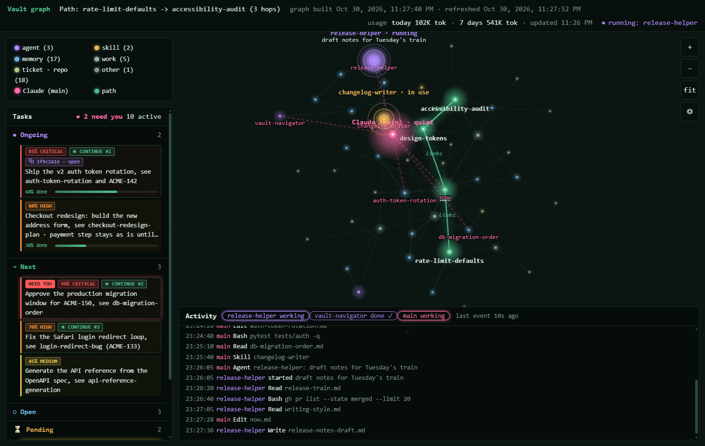
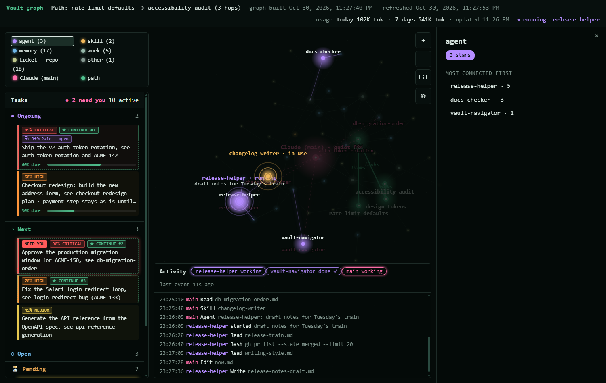
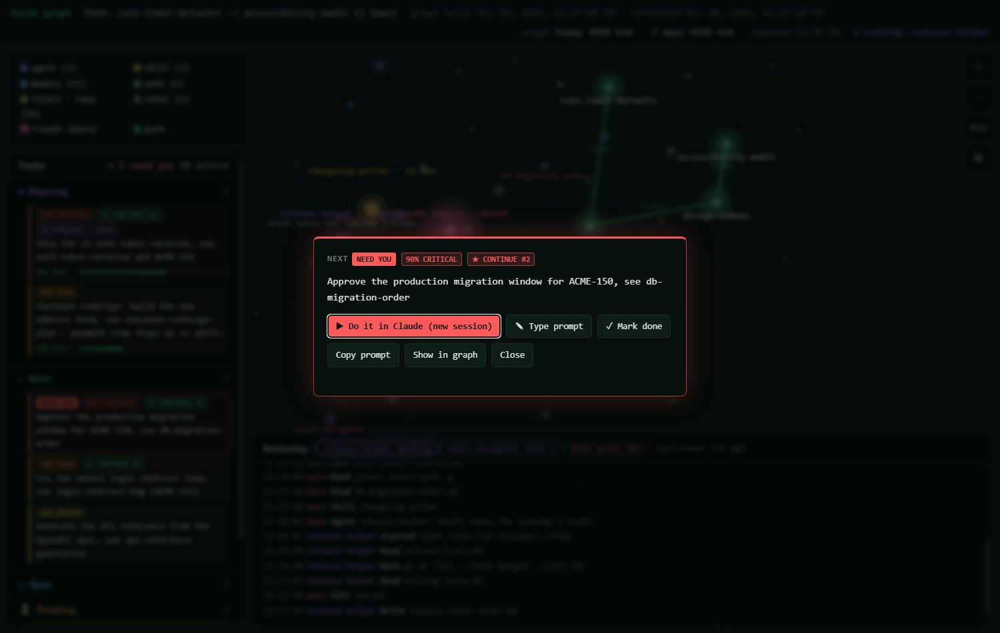

# vault-graph

**A live star map, task board and memory hook for your Markdown notes, built for working with Claude Code.**

Drop one `tools/` folder into an Obsidian (or any Markdown) vault. You get a self-healing index, fast search from the command line, a live graph of how your notes connect, a task board you can hand to Claude with one click, and Claude Code hooks that check your notes before every prompt.



## What it does

- **Live graph.** Every note is a star, colored by kind (memory, work, agent, skill). Wikilinks are lines. Issue keys like `ABC-123` and `owner/repo` GitHub links become shared "entity" stars, so two notes that mention the same ticket sit together.
- **Self-healing indexes.** `heal.py` rebuilds `HOME.md` and one `_index.md` per repo, adds missing front-matter, repoints renamed wikilinks, and reports broken links and duplicate names.
- **Secret scan.** Tokens and keys in notes are reported, and an optional git pre-commit hook blocks the commit.
- **Search without an AI.** `search`, `note`, `related`, `path` and `entity` answer from the files in milliseconds. `path` also lights up the chain in the UI.
- **Task board.** A plain Markdown file with five sections, priorities, progress bars, a "NEED YOU" glow for things only a person can do, and "CONTINUE #1..3" picks for what to do next.
- **Do it in Claude.** Click a task and Claude Code opens on it: it resumes the session the task came from, forks it if that session is open right now, or types the task into the live session when it runs in [wmux](#do-it-in-claude-and-wmux).
- **Claude Code hooks.** Before each prompt, the top vault matches are added to Claude's context. Tool calls, subagents and skills show up live in the activity panel and as pulsing stars.
- **Usage in the top bar.** Token counts from your local Claude Code transcripts. Plan limits (5-hour and weekly %) are available as an [opt-in](#security-notes).
- **Standard library only.** Python 3.10+, no installs. The UI is one HTML file with no external requests.

| Agents and skills | One task, ready to hand to Claude |
|---|---|
|  |  |

## Quick start

Try the demo vault (a made-up team called Acme):

```
git clone https://github.com/sairenchristianbuerano/vault-graph.git
cd vault-graph
python example-vault/demo.py
```

That heals the demo's indexes, builds the graph, writes some fake agent activity, and opens `http://127.0.0.1:8766/`.

Use it on your own vault:

1. Copy the `tools/` folder into your vault, so you have `<vault>/tools/vault.py`.
2. Run:

   ```
   python tools/vault.py sync      # heal, index, build the graph, open the UI
   python tools/vault.py ui        # open the UI again later
   ```

3. Optional: copy `vault-graph.example.json` to `<vault>/vault-graph.json` and change what you need.
4. Add the generated files to your vault's `.gitignore` (see this repo's [.gitignore](.gitignore)).

You can also keep the tools in one place and point them at a vault with `--root <dir>` or the `VAULT_ROOT` environment variable.

### Suggested vault layout

```
HOME.md                 generated map (heal.py owns the AUTO block)
_global/now.md          the task board
_global/memory/         rules that apply everywhere
repos/<repo>/_index.md  one page per repo (generated list below your header)
repos/<repo>/memory/    one fact per note, with front-matter
repos/<repo>/work/      plans, runbooks, reports
.claude/agents/         agents (shown as purple stars)
.claude/skills/         skills (amber stars); link one with [[skill-folder-name]]
```

Folder names are configurable. Notes outside this layout still show up in the graph.

### Commands

```
python tools/vault.py search "token rotation"   ranked notes with the best matching line
python tools/vault.py note auth-token-rotation  description, links, backlinks, sections (--full for all)
python tools/vault.py related auth-token-rotation
python tools/vault.py path rate-limit-defaults accessibility-audit
python tools/vault.py entity ACME-150           every note naming a ticket or owner/repo
python tools/vault.py report                    hubs, bridges, orphans, unlinked mentions
python tools/vault.py task list
python tools/vault.py task add next "Fix the Safari login loop"
python tools/vault.py task move "safari login" done
python tools/heal.py --check                    no writes; exit 1 on problems or secrets
```

## Claude Code integration

```
python tools/vault.py setup --dry-run   # show exactly what would change
python tools/vault.py setup
```

`setup` does four things and prints each one:

1. **Hooks** in `~/.claude/settings.json`. It backs the file up first (`settings.json.vault-graph-<date>.bak`), prints every entry it adds, keeps all your other settings, and changes nothing on a second run.

   | Hook | Command | What it does |
   |---|---|---|
   | `UserPromptSubmit` | `vault.py hook` | Searches the vault for your prompt and adds the top 3 matches to Claude's context. Shows the `daily` results once a day. |
   | `PreToolUse` | `vault.py activity start` | Logs each tool call to `graph/activity-log.jsonl` (secrets redacted, 120 characters max) and marks agents and skills as running. |
   | `PostToolUse` (Agent, Task) | `vault.py activity stop` | Marks a subagent as done. |
   | `SubagentStop` | `vault.py activity stop` | Same, for background agents. |
   | `Stop` | `vault.py activity idle` | Marks the main session as idle. |

   Every hook has a 5 second timeout and swallows its own errors, so it never blocks Claude.
2. **Agents and skills**: only if the vault has `.claude/agents/` or `.claude/skills/`, they are copied to `~/.claude/`. An existing one with different content is left alone unless you pass `--force`.
3. **A pointer** appended to `~/.claude/CLAUDE.md` telling Claude where the vault is.
4. **The git pre-commit secret check**, if the vault is a git repository.

**To undo:** copy the backup back over `~/.claude/settings.json`, or delete the entries whose command contains `vault.py`. Remove the "Memory vault" section from `~/.claude/CLAUDE.md` and any copied agents or skills you do not want.

`sync` also imports Claude Code's auto-memory (`~/.claude/projects/*/memory/*.md`) into the vault. Unmapped projects land in `_inbox/` for you to file; set `auto_memory` in the config to map projects to repo folders or to turn the import off.

## The task board

The board is `_global/now.md` (configurable) with these five sections:

```markdown
# Now: task board (updated 30 Oct 2026)

## Ongoing

- [85%] [done 60%] Ship the v2 token rotation, see [[auth-token-rotation]] (s:3f9c2a1e)
- [60%] Checkout redesign
  - payment step stays as is until ACME-160

## Next

- [90%] @you Approve the migration window for ACME-150

## Open

## Pending

## Done

- 29 Oct: Raised the default rate limit
```

| Syntax | Meaning |
|---|---|
| `[85%]` | Priority. 80+ critical, 60+ high, 40+ medium, below that low. |
| `[done 60%]` | Progress bar. Must come right after the priority. |
| `@you` | Only a person can do this (a sign-in, an approval). The task glows and the section never collapses. |
| `(s:3f9c2a1e)` | The first 8 characters of the Claude Code session it belongs to. `task add` stamps this automatically when run from inside Claude. |
| Indented `  - ` lines | Sub-items. They move with their task. |

The three highest-priority tasks in Ongoing, Next and Open get a **CONTINUE #1..3** badge (already-started work scores a little higher). Pending is skipped because it waits on someone else.

## Do it in Claude (and wmux)

Click a task, then **Do it in Claude**. The server:

- accepts only tasks that are on the board right now (exact text), with a per-run token baked into the page and a Host header check;
- writes the prompt to `graph/last-task-prompt.txt`, so no shell ever parses task text;
- if the task has `(s:...)` and that transcript exists: resumes it with `--resume`, or forks it with `--fork-session` when it was active in the last 10 minutes; if the transcript is over 20 MB it starts a fresh session with a pointer instead;
- starts `claude --permission-mode <mode>` in the session's folder (or `launcher.cwd`, default the vault).

**Type prompt** adds your own note to the prompt. **Mark done** moves the task to Done with your note. **Copy prompt** puts the same prompt on the clipboard.

**Where it opens**

- **Windows with wmux running** (a terminal multiplexer for Windows with a CLI): in a new wmux tab. If the task's session is already running in a wmux tab, the task is typed into it as the next message. If that tab is showing a menu or an approval prompt, it refuses and tells you, rather than typing into it or opening a duplicate.
- **Windows without wmux:** a new PowerShell window.
- **macOS:** a new Terminal window. **Linux:** the first of `x-terminal-emulator`, `gnome-terminal`, `konsole`, `xterm`. If none is found, the page shows the command to run. Windows is the tested platform; macOS and Linux are best effort.

## Configuration

Optional `vault-graph.json` at the vault root. Every key has a safe default; see [vault-graph.example.json](vault-graph.example.json).

| Key | Default | What it does |
|---|---|---|
| `port` | `8765` | UI server port on 127.0.0.1. Env `VAULT_GRAPH_PORT` overrides. |
| `board` | `_global/now.md` | Task board file. |
| `repos_dir` | `repos` | Folder with one subfolder per repo. |
| `global_dir` | `_global` | Rules that apply everywhere; also holds `asks-log.md`. |
| `entity_patterns` | issue keys, github.com owner/repo | Regexes whose matches become shared entity stars. |
| `entity_ignore` | `UTF-8`, `SHA-256`, ... | Matches to skip. |
| `auto_memory.import` | `true` | Import Claude Code auto-memory on `sync`. |
| `auto_memory.strip_prefixes` | `[]` | Prefixes removed from project folder names. |
| `auto_memory.map` | `{}` | Project name to repo folder; `null` skips it. |
| `auto_memory.unmapped` | `_inbox` | `_inbox`, `own` or `skip`. |
| `auto_memory.skip` | `[]` | Note names never to import again. |
| `hook.matches` | `3` | Vault matches added per prompt. |
| `launcher.permission_mode` | `default` | `default`, `acceptEdits`, `plan` or `bypassPermissions`. |
| `launcher.cwd` | the vault | Folder for new sessions without a known folder. |
| `launcher.wmux` | auto | Path to the wmux CLI. |
| `plan_usage` | `false` | Opt-in plan limits in the top bar. |
| `local_usage` | `true` | Token counts from local transcripts. |
| `idle_shutdown` | `1800` | Seconds without a request before the server stops. |
| `daily` | `[]` | Commands for `vault.py daily`. |

The page also supports `#cat=agent` (or any legend category) to open filtered, and `#task=3` to open the third task on the board.

## Scheduling `daily`

`daily` runs each command in the `daily` list, keeps the last 10 lines of output in `graph/daily.json`, and the prompt hook passes them to Claude once a day ("tell the user first"). If the scheduled run was missed, the hook starts it in the background on the first prompt of the day.

```json
"daily": [
  {"name": "open PRs", "cmd": "gh pr list --author @me --state open", "cwd": "~/code/acme-api"},
  {"name": "failing CI", "cmd": ["gh", "run", "list", "--status", "failure", "--limit", "5"]}
]
```

Run it every morning:

- **Windows (Task Scheduler):**

  ```
  schtasks /Create /SC DAILY /ST 09:00 /TN vault-graph-daily /TR "pythonw \"<vault>\tools\vault.py\" daily"
  ```

  `pythonw` runs without a console window; the script handles that.
- **macOS / Linux (cron):** `crontab -e`, then

  ```
  0 9 * * * cd "<vault>" && python3 tools/vault.py daily >/dev/null 2>&1
  ```

## Security notes

- **Localhost only.** The server binds to `127.0.0.1`, stops after 30 minutes without requests, and serves only the page, `graph.json` and a status endpoint.
- **Launcher guard.** `POST /do` needs the random token embedded in the page (other sites cannot read it), a `127.0.0.1` or `localhost` Host header, and the exact text of a task on the board. The prompt is passed through a file, never through shell parsing.
- **Permission mode is `default`.** Launched sessions ask before running tools, as Claude Code normally does. You can set `launcher.permission_mode` to `bypassPermissions`. **Warning:** that lets the launched session run any command and edit any file without asking. The prompt asks Claude to check with you before anything public or irreversible, but nothing enforces it. Only turn it on for a vault and machine where you accept that.
- **Plan usage is opt-in (`"plan_usage": true`).** It reads the OAuth access token from `~/.claude/.credentials.json` on each refresh (every 5 minutes) and sends it only to `https://api.anthropic.com/api/oauth/usage`. The token is never stored, logged or sent anywhere else. That endpoint is undocumented and may change or stop working; the top bar then falls back to local token counts. With it off (the default), the credentials file is never opened.
- **Activity log.** Tool-call details are cut to 120 characters, and anything that looks like a token is replaced with `[redacted]`.
- **Your vault stays yours.** Nothing is uploaded. Keep a vault with real notes in a private repository.

## Requirements

- Python 3.10 or newer (standard library only)
- A modern browser for the UI
- Claude Code for the hooks and the launcher
- Optional: wmux on Windows, for live-session sends and tabs

Run the self-tests:

```
python tools/heal.py --selftest
python tools/vault.py selftest
```

## License

[Apache-2.0](LICENSE)
